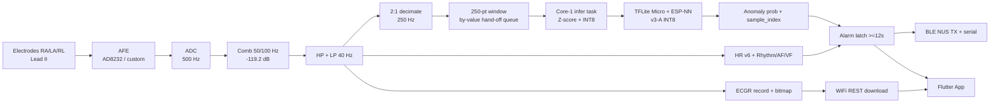

# ESP32-ECG — Portable ECG Acquisition & On-device AI Anomaly Detection (Research Prototype)

> **ESP32-S3 · ESP-IDF · TFLite Micro + ESP-NN · v3-A INT8 · BLE NUS · Flutter**  
> English | [中文](README.md)

**Portable single-lead (Lead II) ECG acquisition research prototype with on-device deep-learning beat-level anomaly detection.** 500 Hz sampling; filtering, heart-rate detection and anomaly inference run on the chip; alarms are pushed to a Flutter app over BLE, and recordings are stored on-board in the ECGR format with WiFi download support. This is a research device — **not a certified medical device and not for clinical diagnosis**.

> **Firmware status (2026-10-25)**: the official firmware is the **ESP-IDF project** `experiments/esp_idf_ecg_migration/` (ESP-IDF v6.0.1). The legacy **Arduino + PlatformIO** line is archived under `legacy_arduino/` for reference only. On-board model: **v3-A** INT8 (167,376 B, `models_ecg_model_v3a_int8_tflite`); firmware runs θ=0.50 + 1-of-5 confirmation + 5-beat cooldown (`main.cc` is authoritative).

## 1. Current Product State (2026-10-25)

- **What it is**: a single-lead ECG acquisition + on-board AI anomaly-detection research prototype. The product model is **v3-A ResNet-L INT8, 167,376 bytes** (SHA256 `7a650a3c…`). It was trained with **mixed abnormality labels** (multi-database abnormal classes merged) — it is **not a dedicated PVC or VF detector**, and the medical meaning of output 1 is not yet bound.
- **Verified board**: SuperMini ESP32-S3FH4R2 (**4MB Quad Flash / 2MB Quad PSRAM**, `sdkconfig.supermini` + `partitions_ecg_supermini.csv`). The 2026-10-23 release build is 1,622,960 B with ~43.7% headroom in the factory slot (2816 KiB). The N16R8 (16MB/8MB) configs remain in the repo, but the 2026-10-23 verification round ran entirely on SuperMini.
- **Async inference repair (2026-10-23)**: window hand-off switched from slot-index/pointer queues to **whole-window by-value messages** (1,004 B/window); queue-full drops are counted and never corrupt in-flight windows; `sample_index` is fixed at window-generation time and travels with the window; reset stops the worker task first, then releases queues/interpreter/arena in order; direct-inference APIs that would share the interpreter concurrently are rejected in async mode.
- **AFE status & capture confirmation (2026-10-23)**: `afeHalInit` returns explicit errors and reuses the ADC on repeated entry; failed checked reads never enter DSP/AI/recording; new `AFE_STATUS` query (mode/ready/valid/error codes/ok/fail counters). The capture script confirms the ADC path from status and valid counts — this proves the ADC path only, **not electrode contact, waveform fidelity, or medical validity**.
- **Preservative boot (2026-10-23)**: SPIFFS mount failure is **never auto-formatted**; boot does not clean records, rebuild the index, or apply retention; **auto-record defaults to off** (explicit `REC_START` / `REC_AUTO 1`); NVS init failure no longer auto-erases. This is not "zero writes at boot": normal radio PHY calibration may update its calibration key.
- **Per-window diagnostics default off**: `AI_VERIFY 0/1` + `AI_TRACE` run only on explicit serial request and never bypass preprocessing, the async queue, quantization, or real inference.

## 2. Build & Use

```bash
# —— SuperMini (4MB Flash / 2MB PSRAM, verified 2026-10-23) ——
cd experiments/esp_idf_ecg_migration   # load the ESP-IDF v6 environment first
idf.py -B build_supermini -D SDKCONFIG=sdkconfig.supermini \
      -D SDKCONFIG_DEFAULTS=sdkconfig.defaults.supermini build
idf.py -B build_supermini -p <PORT> flash
idf.py -B build_supermini monitor       # serial 460800

# —— N16R8 (16MB Flash / 8MB PSRAM) ——
# See FLASH_DUAL_BOARD.md. Note: 16MB defaults link extra replay-corpus arrays and
# must not be used for SuperMini. Choosing sdkconfig.supermini auto-selects the
# SuperMini defaults; explicitly wrong defaults (16MB / wrong partition table)
# fail the build.
```

- **Data-preservation boundary**: `idf.py flash` writes the app partition only; **generic full-chip flashing (e.g. `erase_flash` + full re-flash) is not a way to preserve existing recordings**. To keep on-device records, write the app partition only and verify the target partition table matches `partitions_ecg_supermini.csv` first.
- **Fixed-input board-test build** (optional, default OFF): `-D ECG_FIXED_INPUT_BOARD_TEST=ON` — digital replay through the production analysis chain only; refuses AFE, skips SPIFFS/recording/radio init; does not validate radio or storage.
- **Common serial/BLE commands**: `MODE sim|afe|replay_normal|replay_abnormal` (AFE failures return the concrete error), `AFE_STATUS`, `REC_START`/`REC_STOP`/`REC_AUTO 1|0`, `AI_VERIFY 0|1|STOP` (per-window parity, see the firmware README), `STATUS`, `WAVE 1|0`.
- **PC tools / app**: `python pc_tools/ecg_plotter.py`; `cd ecg_app && flutter run`. AI model training requires a GPU (WSL2).

## 3. Verified Scope (as of 2026-10-23, all on the SuperMini 4MB board)

| Item | Result | Boundary |
|---|---|---|
| 4MB release build & deploy | 1,622,960 B, 43.7% headroom; normal operation after deploy | That artifact only; N16R8 not re-verified |
| Per-window PC/board parity | Two 40s replay segments: **92 windows / 23,000 INT8 input bytes, inputs and both outputs byte-identical** (PC TensorFlow 2.21 BUILTIN_REF vs on-board TFLM/ESP-NN), 0 raw/confirmed mismatches, 0 drops | Fixed digital replay only; does not prove real-ADC fidelity, power, full alarm timing, or diagnostic performance |
| Preservative boot | SPIFFS 983,040 B digest unchanged, 11 records retained; bootloader/partition table/PHY partition unchanged | NVS key `phy/cal_data` updated by PHY calibration — **full-chip byte-invariance is NOT claimed** |
| Async AI repair | Host 104/104 assertions (ASan/TSan clean) + on-board 15-window paced run, 20-window burst queue-full reconciliation, reset+re-init with no stale results | Stubs prove component concurrency logic; "reset mid-Invoke" not reproduced on board |
| AFE status repair | Host 47 assertions + 14 capture-script unit tests + IDF build pass | **No real AFE acquisition**; deployed firmware's final `AFE_STATUS` ok=0/fail=0 (no sampling occurred) |

> Feature presence is not verification: AF/VF detection, real-AFE acquisition, power draw, and the full alarm chain are **not verified in the current round**. The device domain has only 2 historical normal recordings and no device AF positives.

## 4. Research Progress (brief, 2026-10-25)

- **v3-A retained**: preregistered exploration rounds R16–R21 (morphology repair, dual-head/valid gating, domain expansion, mixup, KD-anchored joint training) all failed their gates; v3-A remains the on-board model — see `docs/03_Software_Docs/TUNING_HISTORY.md`.
- **New N/V (normal/ventricular-ectopic) models remain research-side** (a long-run training task started 2026-10-24; live status comes from the task output); **not deployed to firmware**, no final conclusion yet. The equal-weight baseline (2026-10-23, dev set) — N misclassification 3.3%, V detection 87.2% — is an intermediate research result.
- **QRS/PVC morphology capability and record-level AF/VF detection remain research goals**, not shipped product capabilities; the VF/AF rule evaluations under `pc_tools/ecg_dl/reports/` (including those in open PRs) are research evaluations, not product performance claims. The paper's main line has **not been finally decided by the user**.
- **Caveat**: the current dev set has been used for many rounds of analysis, and the old INCART split once had patient-level leakage. The AI metrics below are development-era numbers — **not blind-test results and not proof of cross-device generalization**.

## 5. Archived History (2026-09, see TUNING_HISTORY)

Archived round conclusions, kept for traceability (current state is §1–§4 above):

- **R21 (09-19)**: KD-anchored dual-head joint training failed after two iterations; dual-head direction closed (§120).
- **R18/R19M/R20M (09-18/19)**: dual-head valid gating suppressed motion artifact in 6/6 runs but drifted calibration; frozen-backbone variants closed on TP protection; the four-quadrant design-space map holds (§118/§119).
- **P0 protocol layer (09-14)**: `protocol/ecg_proto.json` single source of truth + four-end golden tests; ECGR v2 dual-version + tolerant truncation (§115).
- **Round-H (09-14)**: fifth alarm source LEADOFF (silent + noisy criteria), validated on device (§114).
- **Round-F/G (09-13)**: inference moved off-loop to core 1, sampling restored to exactly 500 Hz, 160 MHz re-adopted; recording stop-stall 0.8–2.2s → 0.5s (§113).
- **Round-D/E (09-13)**: ludb carrier erratum (§109); VF RMS floor gate (§111); AI-density alarm min-SQI ≥ 0.80 gate (§110); pure-noise retrain v3-N failed three times, v3-A retained (§107).
- **M0–M2 (09-12/13)**: -O2 / two-stage advertising / 240 MHz kept; M1 latched alarm state machine (**latch ≥12s**, adjusted 30s→12s on 2026-10-19, `main.cc` authoritative) + UART command channel; 30-case on-board noise corpus (§104–§106).
- **R16 device loop (exp7c era)**: first on-board 90s three-mode test, device vs PC correlation 0.886/0.827 — **exp7c numbers are not v3-A metrics**.
- **P1-1 A1 Gate (09-14)**: R18 binary gate FAIL (only 1/3 seeds passed, that seed Sn=0.058); decision FAIL_TO_3CLASS; evidence `pc_tools/ecg_dl/models/gate/r18_gate_*.json`, TUNING_HISTORY §116.
- **ECG Plotter serial fix (09-14)**: firmware supports `WAVE 1/0` serial streaming (default off); Plotter DTR/RTS init fixed. The prebuilt exe was not rebuilt; run `python pc_tools/ecg_plotter.py`.

---

## Features

| Area | Details |
|------|---------|
| Acquisition | 500 Hz, 3-channel (clean / noisy / filtered); sources: simulator, real AFE, MIT-BIH replay |
| Filtering | Two-stage comb (50/100 Hz nulling, -119.2 dB) → HP → LP 40 Hz |
| Heart rate | Energy-envelope QRS detector v6 (LUDB: F1 0.868, Se 96.4%, BPM MAE 4.16) |
| AI | v3-A ResNet-L INT8 (167,376 B, mixed abnormality labels); TFLite Micro + ESP-NN; beat-level anomaly detection |
| Rhythm | Asystole / bradycardia / tachycardia (rules), AF (CV+entropy), VF/VT (DSP features + LR) — research goals, not verified product capabilities |
| Alarm | Physiological sources latch ≥12s (BLE alarm bit + source bitmap) |
| Recording | ECGR format (32 B header + int16 stream + abnormal bitmap); **auto-record defaults off**, explicitly enableable; WiFi REST download |
| Communication | BLE NUS (TX/RX) + WiFi HTTP; Flutter app on mobile |

---

## Architecture



- **Core assignment**: the sampling/filter/comms/storage main task runs on core 0 (IDF affinity); AI inference runs in a dedicated core-1 task (whole-window by-value queue, drops counted).
- **Pipeline**: 500 Hz → causal filtering → 2:1 decimation → 250-pt window → normalization → INT8 → inference → dequantized anomaly probability.

---

## Directory Layout

```
experiments/esp_idf_ecg_migration/  # official ESP-IDF firmware line (README has build/verification details)
  main/                            # main (sampling/filter/HR/alarm/record/BLE/WiFi)
  components/                      # ecg_ai · ecg_core · ecg_ble · ecg_wifi · ecg_storage · ecg_afe
                                   # + esp-tflite-micro · esp-nn (vendored)
legacy_arduino/                    # legacy Arduino/PlatformIO line (archived)
pc_tools/                          # PC tools: ecg_plotter + ecg_dl (train/eval/export)
ecg_app/                           # Flutter mobile app
web/                               # web recording-download frontend
protocol/                          # ecg_proto.json — single protocol source of truth
docs/                              # papers & results (authoritative numbers: docs/01_Project_Overview/FINAL_RESULTS.md)
test/                              # tests
papers/                            # literature
```

---

## AI Model & Metrics (development-era numbers, not blind-test)

**On-board model**: v3-A clean baseline (ResNet-L, ~80K params), INT8 **167,376 B**, on-device since 2026-09 (replaces exp7c). **Mixed-abnormality-label** binary classifier. Paper operating point: beat θ≈0.35 / patient θ≈0.5; **firmware runs θ=0.50 + 1-of-5 + cooldown 5** (`main.cc` is authoritative).

| Cadence | Model | MIT-AUC | MIT-R@0.5 | PTB-AUC | PTB-R@0.5 |
|------|------|:---:|:---:|:---:|:---:|
| Patient-level clean / un-augmented | exp5 | 0.9295 | 0.9264 | 0.7845 | 0.6281 |
| Patient-level clean / un-augmented | exp6 | 0.8942 | 0.9194 | **0.8232** | 0.7019 |
| Cross-domain (no PTB training) | P2A | **0.9878** | 0.9312 | 0.7502 | 0.2552 |
| Deploy chain (D3, δ-aligned) | exp6-SGD | 0.9122 | 0.9102 | 0.7697 | 0.7069 |

> The two cadences (patient-level clean/un-augmented vs deploy chain D3) are not directly comparable. **These are development-set-era numbers**: the dev set has been reused across analysis rounds and the old INCART split once had patient-level leakage, so they are neither blind-test results nor proof of cross-device generalization.

---

## Toolchain

- **PC plotting** `pc_tools/ecg_plotter.py`: real-time 3-channel waveform + AI anomaly labels (packaged as ECG-Plotter.exe).
- **Deep learning** `pc_tools/ecg_dl/`: training / INT8 export / evaluation (patient-level leakage-free split + SplitGuard).
- **Mobile app** `ecg_app/`: BLE NUS waveform display, AI-highlighted alarms, recording list/playback.

---

## Docs

User-facing details are in the per-module `README.md` files (`pc_tools/ecg_dl/`, `ecg_app/`, `web/`, `experiments/esp_idf_ecg_migration/`). Firmware build commands, preservative boot, and per-window diagnostics: `experiments/esp_idf_ecg_migration/README.md`; dual-board configuration: `experiments/esp_idf_ecg_migration/FLASH_DUAL_BOARD.md`.

---

## License

[MIT](LICENSE)
