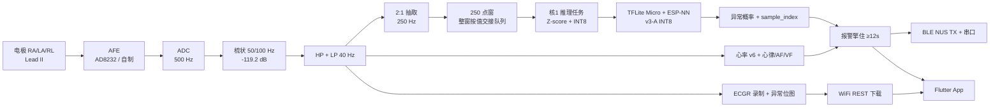

# ESP32-ECG 心电采集与 AI 异常检测系统（研究原型）

> **ESP32-S3 · ESP-IDF · TFLite Micro + ESP-NN · v3-A INT8 · BLE NUS · Flutter**  
> [English](README.en.md) | 中文

**便携式单导联（Lead II）心电采集研究原型 + 板载深度学习逐拍异常检测。** 500 Hz 采样，片上完成滤波、心率检测与异常推理，异常经 BLE 推送手机 App，数据以 ECGR 格式板载录制并支持 WiFi 下载。本项目为研究性质装置，**未经过医疗器械认证，不用于临床诊断**。

> **固件线状态（2026-10-25）**：官方固件为 **ESP-IDF 工程** `experiments/esp_idf_ecg_migration/`（ESP-IDF v6.0.1）。旧 **Arduino + PlatformIO** 线已归档至 `legacy_arduino/`，仅历史参考，不再构建/烧录。板上模型 **v3-A** INT8（167,376 B，`models_ecg_model_v3a_int8_tflite`），固件运行 θ=0.50 + 1-of-5 确认 + 冷却 5 拍（以 `main.cc` 为准）。

## 1. 当前产品状态（2026-10-25）

- **形态**：单导联 ECG 采集 + 板载 AI 异常检测的研究原型；产品模型为 **v3-A ResNet-L INT8，167,376 字节**（SHA256 `7a650a3c…`）。它是**混合异常标签**训练的二分类模型（MIT-BIH/PTB 等多库异常合并为正类），**不是 PVC 或 VF 专用检测器**，输出 1 的医学类别绑定尚未确立。
- **已实测板型**：SuperMini ESP32-S3FH4R2（**4MB Quad Flash / 2MB Quad PSRAM**，`sdkconfig.supermini` + `partitions_ecg_supermini.csv`）。2026-10-23 正式版构建 1,622,960 B，factory 槽（2816 KiB）余约 43.7%。N16R8（16MB/8MB）配置仍在仓内，但 2026-10-23 验证轮全部在 SuperMini 上完成。
- **异步推理修复（2026-10-23）**：窗口交接从"槽号/指针队列"改为**整窗按值消息**（1,004 B/窗）；队满丢窗有计数、不破坏在途窗口；`sample_index` 在窗口生成时固定并随窗传递；reset 先停推理任务再按序释放队列/interpreter/arena；异步模式下拒绝会并发共用 interpreter 的直接推理 API。
- **AFE 状态与采集确认（2026-10-23）**：`afeHalInit` 返回明确错误、重复进入复用 ADC；checked read 失败的样本不进入 DSP/AI/录制；新增 `AFE_STATUS` 查询（mode/ready/valid/错误码/ok/fail 计数）。采集脚本按状态与有效计数确认 ADC 路径——这只证明 ADC 通路，**不证明电极接触、波形保真或医学有效性**。
- **保留式启动（2026-10-23）**：SPIFFS 挂载失败**不自动格式化**；启动不清理记录、不重建索引、不执行保留删除；**自动录制默认关闭**（`REC_START` / `REC_AUTO 1` 显式开启）；NVS 初始化失败不自动擦除。不能说成"启动绝对零写入"：正常无线 PHY 校准可能更新其校准键。
- **逐窗诊断默认关闭**：`AI_VERIFY 0/1` + `AI_TRACE` 仅显式串口请求触发，不旁路前处理/异步队列/量化/真实推理。

## 2. 构建与使用

```bash
# —— SuperMini（4MB Flash / 2MB PSRAM，2026-10-23 已验证）——
cd experiments/esp_idf_ecg_migration   # 先加载 ESP-IDF v6 环境
idf.py -B build_supermini -D SDKCONFIG=sdkconfig.supermini \
      -D SDKCONFIG_DEFAULTS=sdkconfig.defaults.supermini build
idf.py -B build_supermini -p <PORT> flash
idf.py -B build_supermini monitor       # 串口 460800

# —— N16R8（16MB Flash / 8MB PSRAM）——
# 参考 FLASH_DUAL_BOARD.md；注意 16MB 默认配置会链接额外的回放语料数组，
# 不能用于 SuperMini。选 sdkconfig.supermini 时 CMake 自动选 SuperMini defaults，
# 显式给出错误 defaults（16MB/错误分区表）时构建会直接报错。
```

- **数据保留边界**：`idf.py flash` 只写应用分区；**通用全量刷写（如 `erase_flash` + 整片重刷）不是保留既有记录的方法**。需要保留板上记录时，只写应用分区、不擦数据分区，并先核实目标板分区表与 `partitions_ecg_supermini.csv` 一致。
- **固定输入板测构建**（可选，默认 OFF）：`-D ECG_FIXED_INPUT_BOARD_TEST=ON`——只跑数字回放与产品分析链，拒绝 AFE、跳过 SPIFFS/录制与无线初始化；不验证无线与存储。
- **常用串口/BLE 命令**：`MODE sim|afe|replay_normal|replay_abnormal`（AFE 失败时返回具体错误）、`AFE_STATUS`（ADC 就绪/有效/计数）、`REC_START`/`REC_STOP`/`REC_AUTO 1|0`、`AI_VERIFY 0|1|STOP`（逐窗核对，详见固件 README）、`STATUS`、`WAVE 1|0`。
- **PC 工具 / App**：`python pc_tools/ecg_plotter.py`；`cd ecg_app && flutter run`。AI 模型训练需 GPU（WSL2）。

## 3. 已验证范围（截至 2026-10-23，均在 SuperMini 4MB 板上）

| 项 | 结果 | 边界 |
|---|---|---|
| 4MB 正式版构建与部署 | 1,622,960 B，余 43.7%；部署后正常运行 | 仅该构建产物；未验证 N16R8 |
| 逐窗 PC/板端一致性 | 回放两段各 40s：**92 窗 / 23,000 INT8 输入字节，输入与两路输出逐字节一致**（PC TensorFlow 2.21 BUILTIN_REF vs 板端 TFLM/ESP-NN），raw/confirmed 0 不一致、0 丢窗 | 仅固定数字回放；不证明真实 ADC 保真、功耗、完整报警时序或诊断性能 |
| 保留式启动 | SPIFFS 983,040 B 摘要不变、记录 11 条未删；bootloader/分区表/PHY 分区不变 | NVS 27 键中 `phy/cal_data` 因 PHY 校准更新，**不能宣称全片逐字节不变** |
| AI 异步修复 | host 104/104 断言（ASan/TSan 零报告）+ 板测 15 窗节奏化、20 窗 burst 队满对账、reset 重 init 无旧结果 | stub 证明组件并发逻辑；板上未复现"Invoke 中 reset"场景 |
| AFE 状态修复 | host 47 项断言 + 采集脚本 14 项单测 + IDF 构建通过 | **未做真实 AFE 采集**；部署固件最终 `AFE_STATUS` ok=0/fail=0（无采样发生） |

> 上表中"功能存在"不等于"验证通过"：AF/VF 检测、真实 AFE 采集、功耗与完整报警链路均**未在当前轮验证**。设备域历史正常录音仅 2 条、无设备 AF 正样本。

## 4. 研究进展（简要，2026-10-25）

- **v3-A 保留决策**：R16–R21 多轮预注册探索（形态学修复、双头/valid 门控、域扩展、mixup、KD 锚定联合训练）均未过门槛，v3-A 仍是板上模型——详见 `docs/03_Software_Docs/TUNING_HISTORY.md`。
- **N/V（正常/室性异位）新模型仍在研究侧训练中**（2026-10-24 起长程任务进行中，实时状态以任务输出为准）；**未部署到固件**，未形成最终结论。等权基线（2026-10-23，开发集）N 误判 3.3%、V 检出 87.2%，属研究中间结果。
- **QRS/PVC 形态能力与 AF/VF 记录级检测仍是研究目标**，不是已交付的产品能力；仓内 `pc_tools/ecg_dl/reports/` 下的 VF/AF 规则评测（含 open PR 中的）是研究评测，不是产品性能声明。论文主线（AF 优先/形态优先等）**尚未由用户最终裁定**。
- **口径警示**：当前开发集已用于多轮分析；旧 INCART 划分曾存在患者级泄漏。下文 AI 指标为开发期数字，**不是盲测结果，也不构成跨设备泛化证明**。

## 5. 历史轮次归档（2026-09，详见 TUNING_HISTORY）

以下为已归档的历史轮次结论（保留供追溯，状态以第 1–4 节为准）：

- **R21（09-19）**：KD 锚定双头联合训练两迭代未过线，双头方向整体关闭（§120）。
- **R18/R19M/R20M（09-18/19）**：双头 valid 门控 6/6 压制运动伪迹但校准漂移；冻结骨干变体因 TP 保护项关闭；四象限设计空间图谱成立（§118/§119）。
- **P0 协议层（09-14）**：`protocol/ecg_proto.json` 单一真值源 + 四端金样测试；ECGR v2 双版本 + 截断容忍（§115）。
- **Round-H（09-14）**：LEADOFF 第五报警源（静默型+噪声型）上板验证（§114）。
- **Round-F/G（09-13）**：推理出环到核 1、采样恢复精确 500Hz、160MHz 重新采纳；录制停顿 0.8–2.2s→0.5s（§113）。
- **Round-D/E（09-13）**：ludb 载波勘误（§109）；VF RMS 下限门控（§111）；AI 密度报警 min-SQI≥0.80 门（§110）；纯噪声重训 v3-N 三连败保留 v3-A（§107）。
- **M0–M2（09-12/13）**：-O2/两档广播/240MHz 维持；M1 报警擎住状态机（**擎住 ≥12s**，2026-10-19 由 30s 调整为 12s，`main.cc` 为准）+ UART 命令通道；30 case 板上噪声语料（§104–§106）。
- **R16 设备闭环（exp7c 时代）**：官方固件首次上板 90s 三模式测试，设备 vs PC 相关 0.886/0.827——**exp7c 数字不能当 v3-A 指标**。
- **P1-1 A1 Gate（09-14）**：R18 二分类 gate FAIL（仅 1/3 seed 过线且 Sn=0.058），决策 FAIL_TO_3CLASS；证据 `pc_tools/ecg_dl/models/gate/r18_gate_*.json`、TUNING_HISTORY §116。
- **ECG Plotter 串口修复（09-14）**：固件支持 `WAVE 1/0` 串口流（默认关）；Plotter 修正 DTR/RTS 初始化。预编译 exe 未重建，运行 `python pc_tools/ecg_plotter.py`。

---

## 特性

| 类别 | 内容 |
|------|------|
| 采集 | 500 Hz 三通道（clean / noisy / filtered），信号源：模拟发生器 / 真实 AFE / MIT-BIH 回放 |
| 滤波 | 双级梳状（50/100 Hz 陷零，-119.2 dB）→ HP → LP 40 Hz |
| 心率 | 能量包络 QRS 检测 v6（LUDB：F1 0.868、Se 96.4%、BPM MAE 4.16） |
| AI | v3-A ResNet-L INT8（167,376 B，混合异常标签），TFLite Micro + ESP-NN，逐拍异常检测 |
| 心律 | 停搏 / 过缓 / 过速（规则）、房颤（CV+熵）、VF/VT（DSP 特征+LR）——研究目标，非已验证产品能力 |
| 报警 | 生理报警源擎住 ≥12s（BLE 报警位 + 源位图） |
| 记录 | ECGR 格式（32B 头 + int16 流 + 异常位图）；**自动录制默认关闭**，可显式开启；WiFi REST 下载 |
| 通信 | BLE NUS（TX/RX）+ WiFi HTTP；手机端 Flutter App |

---

## 架构



- **核心分工**：采样/滤波/通信/存储在主任务（核 0/1 由 IDF 调度），AI 推理在核 1 独立任务（整窗按值队列交接，队满丢窗有遥测计数）。
- **数据流**：500Hz → 因果滤波 → 2:1 抽取 → 250 点窗 → 归一化 → INT8 → 推理 → 反量化取异常概率。

---

## 目录结构

```
experiments/esp_idf_ecg_migration/  # 官方 IDF 固件线（README 含构建/验证细节）
  main/                            # 主程序（采样/滤波/心率/报警/记录/BLE/WiFi）
  components/                      # ecg_ai · ecg_core · ecg_ble · ecg_wifi · ecg_storage · ecg_afe
                                   # + esp-tflite-micro · esp-nn（vendored）
legacy_arduino/                    # 旧 Arduino/PlatformIO 线（已归档）
pc_tools/                          # PC 工具：ecg_plotter + ecg_dl（训练/评估/导出）
ecg_app/                           # Flutter 手机 App
web/                               # Web 记录下载前端
protocol/                          # ecg_proto.json 三端协议单一真值源
docs/                              # 论文与结果文档（权威数字：docs/01_Project_Overview/FINAL_RESULTS.md）
test/                              # 测试代码
papers/                            # 文献
```

---

## AI 模型与指标（开发期数字，非盲测）

**板上模型**：v3-A clean baseline（ResNet-L，~80K 参数），INT8 **167,376 B**，2026-09 上板（接替 exp7c）。**混合异常标签**二分类。论文口径最优操作点 beat θ≈0.35 / patient θ≈0.5；**固件运行 θ=0.50 + 1-of-5 + 冷却 5**（以 `main.cc` 为准）。

| 口径 | 模型 | MIT-AUC | MIT-R@0.5 | PTB-AUC | PTB-R@0.5 |
|------|------|:---:|:---:|:---:|:---:|
| 患者级清洁/未增强测试 | exp5 | 0.9295 | 0.9264 | 0.7845 | 0.6281 |
| 患者级清洁/未增强测试 | exp6 | 0.8942 | 0.9194 | **0.8232** | 0.7019 |
| 跨域参考（无 PTB 训练） | P2A | **0.9878** | 0.9312 | 0.7502 | 0.2552 |
| 部署链（D3，δ 对齐） | exp6-SGD | 0.9122 | 0.9102 | 0.7697 | 0.7069 |

> 两表口径不同（患者级清洁/未增强 vs 部署链 D3），不可直接比较。**以上为开发集时期的评估数字**：开发集已用于多轮分析、旧 INCART 划分曾存在患者泄漏，故不构成盲测成绩或跨设备泛化证明。

---

## 工具链

- **PC 绘图** `pc_tools/ecg_plotter.py`：实时三通道波形 + AI 异常标签（可打包 ECG-Plotter.exe）。
- **深度学习** `pc_tools/ecg_dl/`：训练 / INT8 导出 / 评估（患者级无泄漏划分 + SplitGuard 守卫）。
- **手机 App** `ecg_app/`：BLE NUS 波形显示、AI 高亮报警、记录列表/回放。
- **跨 Shell 协作**：`scripts/project_paths.json`（唯一路径真值）+ 读取器 + `scripts/cross_shell.py` 调度器；规则见 `docs/03_Software_Docs/AGENTS.md`（内部）。

---

## 文档

面向用户的说明见各子项目 `README.md`（`pc_tools/ecg_dl/`、`ecg_app/`、`web/`、`experiments/esp_idf_ecg_migration/`）。固件构建命令、保留式启动与逐窗诊断详见 `experiments/esp_idf_ecg_migration/README.md`；双板配置见 `experiments/esp_idf_ecg_migration/FLASH_DUAL_BOARD.md`。

---

## 许可

[MIT](LICENSE)
