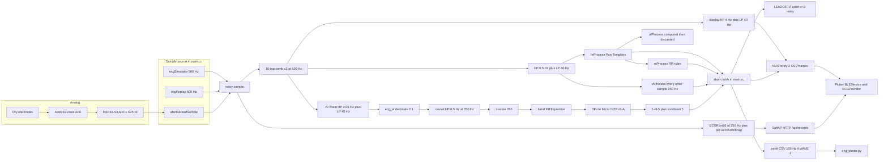
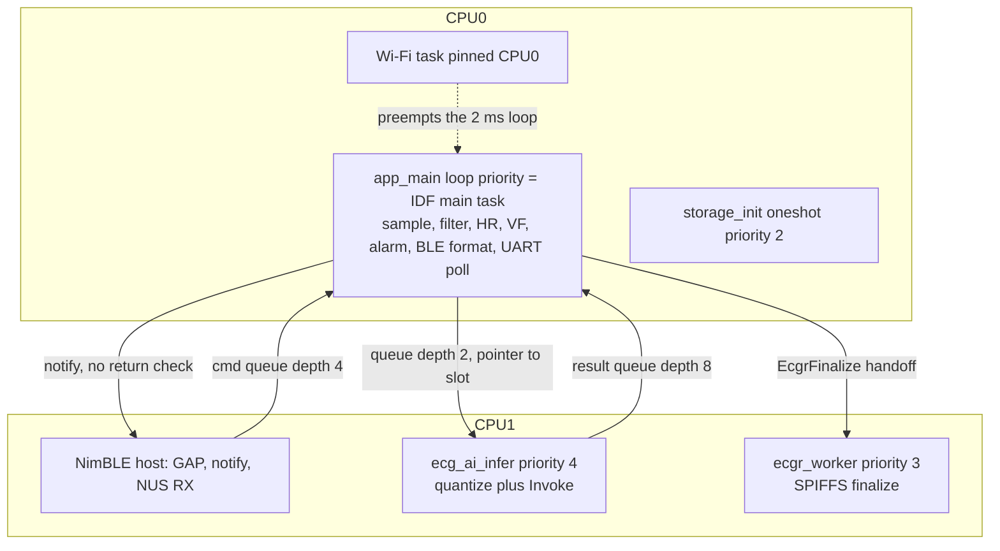
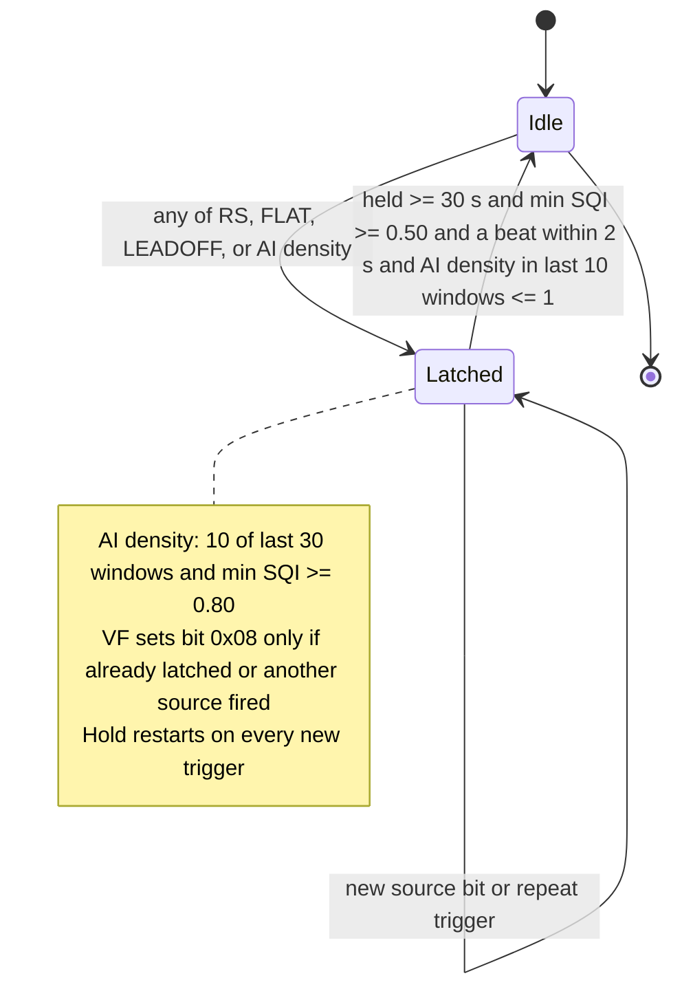

# ESP32-ECG core code review (2026-10-19)

Review of the product path that is actually on `main`: firmware in `experiments/esp_idf_ecg_migration`, the contract in `protocol/ecg_proto.json`, the Flutter app in `ecg_app/`, and the PC plotter in `pc_tools/ecg_plotter.py`. The on-device model symbol is `models_ecg_model_v3a_int8_tflite` (`ECG_MODEL_NAME` = `"v3-A"`). Research training scripts under `pc_tools/ecg_dl/` were used only to check quantization and class index. `legacy_arduino/` was compared only for divergence.

The findings below are the review of the tree as it was. The Critical and High items that could be fixed without moving the v3-A model are now patched; see section 7 for the changelog and what was actually run.

## How to read this

1. The three diagrams are the runtime: who owns which buffer, which task runs on which core, and how an alarm becomes a BLE column.
2. The module table is the map of entry points and the single protocol file.
3. The findings table is the review. Each item has the file, why it changes behavior, and a fix direction. Style nits are not listed.
4. The last section is what already matches across firmware, app, and PC, so those paths do not need to be re-litigated.

---

## 1. Architecture

Analog path assumed by the firmware: dry electrodes into an AD8232-class analog front end, DC near 1.65 V, into ESP32-S3 ADC1 (default GPIO4, 12-bit, 12 dB). Acquisition is not a hardware timer ISR. `app_main` spins a software loop and then `vTaskDelayUntil(..., 2)` with `CONFIG_FREERTOS_HZ=1000`, so the nominal period is 2 ms (500 Hz). Anything that runs inside that loop (filters, VF window math, `printf`, SPIFFS, a Wi-Fi task on the same core) stretches the period. `s_loopOverruns` counts iterations whose own work exceeded 2 ms.



### ESP-IDF task graph

`sdkconfig` pins the main task to CPU0 and the Wi-Fi task to CPU0. NimBLE is pinned to CPU1 (`CONFIG_BT_NIMBLE_PINNED_TO_CORE_1`). The comment in `ecg_ai.cpp` that the infer task is "below main (priority 5)" is not backed by this sdkconfig: `CONFIG_ESP_MAIN_TASK_PRIO` is not set here. Infer priority 4 and the recorder worker priority 3 are explicit.



There is no ADC ISR and no ring between the converter and `app_main`. The "ring buffers" in the product are software: the AI 250-sample window, the VF 1250-sample block, the LEADOFF 750-sample block, the heart-rate moving-window integrator, and the Flutter 1500-sample list.

### Alarm latch

Live column 8 is not the raw model bit. It is `s_alarmLatched`, held at least 30 s. Column 10 (`asrc`) is the OR of sources seen during the hold. A source can refresh the hold and extend the bitmap.



Per-second inputs into that latch:

| Bit | Name | Armed by |
|---|---|---|
| `0x01` | AI | `alarmAiDensity(30) >= 10` and this second's min SQI `>= 0.80` |
| `0x02` | RS | `rsProcess`: one RR `>= 4 s`, or 30 s mean HR `< 40` or `> 180` with mean SQI `>= 0.5` |
| `0x04` | FLAT | this session has seen a beat, and `now - s_lastBeatSeenMs >= 4000` (not `hrGetLastBeatMillis`, which a soft reset refreshes) |
| `0x08` | VF | `vfProcess` two-window confirm, session has seen a beat, last beat older than 2.5 s, window RMS `>= 0.05` |
| `0x10` | LEADOFF | quiet RMS `< 0.05` for 2 s, or 8 of last 10 s in the noise / low-crest band, and not inside the 6 s VF block |

---

## 2. Module map

| Path | Owns | Entry |
|---|---|---|
| `experiments/esp_idf_ecg_migration/main/main.cc` | 500 Hz loop, mode switch, alarm latch, LEADOFF, BLE/UART CSV, command parser | `app_main` |
| `main/model.cc` + `model.h` | locked v3-A INT8 flatbuffer | `models_ecg_model_v3a_int8_tflite` |
| `components/ecg_afe` | oneshot ADC, optional curve-fit calibration | `afeHalInit`, `afeHalReadSample` |
| `components/ecg_core` | comb is in `main.cc`; biquads, heart rate, RS, AF, VF, simulator, replay | `applyFilter`, `hrProcess`, `rsProcess`, `vfProcess`, `ecgReplayNextSample` |
| `components/ecg_ai` | decimate, second HP, z-score, INT8 fill, invoke, confirm/cooldown, async handoff | `ecg_ai_init`, `ecg_ai_feed_sample` |
| `components/ecg_ble` | NimBLE NUS, notify, RX line queue | `initBLE`, `sendBLEMessage` |
| `components/ecg_storage` | SPIFFS `.ecgr`, RAM capture, async finalize | `ecgRecorderStart/PushSample/SetSecondAsrc/Stop` |
| `components/ecg_wifi` | SoftAP `ESP32-ECG-xxxx`, HTTP records | `ecgWifiStart` called from `app_main` before the loop |
| `protocol/ecg_proto.json` | contract version 2: CSV columns, asrc bits, commands, ECGR layout, Wi-Fi and cloud routes | generators below |
| `scripts/gen_protocol_constants.py` | C header, Dart `ProtocolGenerated`, JS `protocol_generated.js` | do not hand-edit those outputs |
| `scripts/gen_protocol_golden.py` | `protocol/golden/*` used by the three golden tests | decimal asrc, not the `0x` examples inside the JSON |
| `ecg_app/lib/services/ble_service.dart` | scan, MTU 185, notify parse, NUS write | `BLEService.connectTo` |
| `ecg_app/lib/providers/ecg_provider.dart` | 1500-point ring, alarm episode state machine | `_addSample` |
| `ecg_app/lib/services/csv_parser.dart` | shared CSV parse | `parseEcgCsvLine` |
| `ecg_app/lib/services/ecg_record_codec.dart` | ECGR decode, little-endian | `EcgRecordCodec.decode` |
| `pc_tools/ecg_plotter.py` | serial CSV plot, `WAVE 1` / `MODE` | `serial_reader` |
| `web/js/ecg-core.js` | same CSV and ECGR rules for the browser | `parseCsvLine`, `parseEcgr` |
| `legacy_arduino/` | previous firmware. Not on the product boot path | see divergence note |

`protocol/ecg_proto.json` is the source of truth for column order, asrc bit values, ECGR offsets, and the command list. Two generated artifacts intentionally diverge from a literal reading of that file:

- `ble.frame.golden` inside the JSON writes asrc as `0x01` / `0x14`. The generator, the golden fixture, and `main.cc` (`%u`) all use decimal `1` / `20`. Live parsers agree with decimal. The JSON examples do not.
- `columns_v2[8].description` says confidence is `1 - p_abnormal`. Firmware stores output index 1 and thresholds it at 0.50 (`ecg_ai.cpp`). Training labels are class 0 and class 1 (`train_clean_baseline_v3.py`). The live number is class-1 probability, not one minus that probability.

ECGR endianness itself is consistent: `_ecgr_write32le` / `_ecgr_write16le` in the C header, `_readU32LE` in Dart, `readU32LE` in `ecg-core.js`. There is no CRC on CSV or ECGR. A flipped digit is accepted as a real sample.

Nominal rates, which are easy to mix up:

| Stream | Rate | Clock |
|---|---|---|
| `app_main` loop | 500 Hz nominal | 2 ms software delay |
| Heart rate, display filter, AI pre-decimate | 500 Hz | same loop |
| AI window, VF, LEADOFF ring, ECGR samples | 250 Hz | `frame % 2 == 0` or `decim_ctr & 1` |
| BLE CSV | 125 Hz | `frame % 4 == 0`, two frames per notify |
| UART CSV | 100 Hz | `frame % 5 == 0`, only after `WAVE 1` |

---

## 3. Findings

| ID | Sev | Where | What breaks |
|---|---|---|---|
| F1 | Critical | `ecg_recorder.cpp` `SetSecondAsrc` | v2 recording bitmap stores `0` or `0x01` only. LEADOFF / VF / FLAT / RS are rewritten as AI. |
| F2 | High | `rhythm_safety.cpp` window scan | "last 30 s" HR is the oldest 30 s in a 120-beat buffer. Brady/tachy is stuck, then late by about a minute. |
| F3 | High | `ecg_ai.cpp` INT8 fill | Every negative sample is quantized one LSB toward zero versus `np.round`. |
| F4 | High | `main.cc` loop + `vf_detect.cpp` + Wi-Fi on CPU0 | 500 Hz is software-timed. The 5 s VF window runs `qsort` of 1250 floats on that loop. Wi-Fi is pinned to the same core. |
| F5 | High | `ble.cpp` `sendBLEMessage` | Notify larger than the negotiated MTU is dropped, the return code is ignored, and HELLO is cleared anyway. |
| F6 | High | `ble_service.dart` + `csv_parser.dart` | `REC_LIST` index lines are numeric CSV and are plotted as ECG. |
| F7 | High | `ecg_provider.dart` + `ecg_waveform.dart` | Paper speed assumes every frame arrived. Lost notifies compress time. Y axis numbers are the raw channel labeled mV. |
| F8 | High | `ecg_wifi.cpp` DELETE | File is removed; `records.idx` is not rebuilt. List keeps serving the dead id. |
| F9 | High | `ecg_plotter.py` open sequence | DTR is pulsed (board reset on typical ESP auto-reset wiring), then `WAVE 1` is sent after 0.5 s. |
| F10 | Medium | `ecg_recorder.cpp` finalize vs index | Header duration can be `finalDur` while the index size uses `durationSec`. |
| F11 | Medium | `main.cc` second boundary | A stall that skips wall-clock seconds only advances LEADOFF and the recording bitmap by one second. |
| F12 | Medium | `ecg_ai.cpp` async slots | Slot 0 can be overwritten while its pointer is still queued if invoke ever stalls past two windows. |
| F13 | Medium | `afe_hal.cpp` | `afeHalInit` calls `adc_oneshot_new_unit` on every entry to AFE mode and never deletes the unit. |
| F14 | Medium | `ecg_wifi.cpp` list buffers | List JSON and the index read are both capped at 4096 bytes with no truncation flag. |
| F15 | Medium | `main.cc` vs `vf_detect.h` vs replay comments | Replay VF scale and the unit word "V" do not match the Arduino comment or the header. |
| F16 | Low | `ecg_proto.json` golden strings | Embedded examples use `0x14`. Generator and firmware use decimal `20`. |
| F17 | Low | `filter.h` vs `filter.cpp` | Header still describes the display chain as a median baseline filter. The code is a 4 Hz high-pass. |
| F18 | Low | `ecg_provider.dart` | `_droppedCount` is never incremented. `List.removeAt(0)` shifts up to 1500 samples on every notify. |

### F1. Recording bitmap drops every asrc bit except AI

`ecgRecorderSetSecondAsrc` is what `main.cc` calls once per wall-clock second with the real mask (`ruleHits`, latched bits, and AI). The implementation stores the byte inside the bool helper, then assigns the real mask:

```cpp
// ecg_recorder.cpp
void ecgRecorderSetSecondAsrc(uint8_t asrc) {
    ecgRecorderSetSecondAbnormal(asrc != 0);
    g_currentSecondAsrc = asrc;   /* 覆盖 bool 兜底的 AI 位 */
}
```

`ecgRecorderSetSecondAbnormal` first forces the mask to `0x01` or `0`, and while a recording is open it writes that value into the bitmap before the caller can restore the real mask:

```cpp
// ecg_recorder.cpp
void ecgRecorderSetSecondAbnormal(bool abnormal) {
    g_currentSecondAbnormal = abnormal;
    g_currentSecondAsrc = abnormal ? 0x01 : 0;
    ...
            g_bmpBuf[need - 1] = g_currentSecondAsrc;
```

The file header still says the bitmap is an asrc mask (`ECGR_RESERVED0_ABNORMAL_IS_ASRC` in `ecgrHeaderInit`). Dart and JS then render every abnormal second as AI. Live BLE column 10 is unaffected: `main.cc` prints `s_alarmSrc` directly.

A normal second stays `0`. An AI-only second stays `0x01` by accident. LEADOFF (`0x10`), FLAT (`0x04`), RS (`0x02`), VF (`0x08`), and any combination are stored as `0x01`.

Fix direction: set the mask, then write the bitmap from that mask, and stop the bool helper from clobbering it. Add a host test that records one second of `0x14` and reads the byte back. Do not change the on-wire BLE column.

### F2. Rhythm-safety window looks at the oldest 30 seconds

The header says the result is the mean HR of the last 30 s (`RS_WIN_S`, buffer of 120 beats). The scan starts at the oldest beat and stops at the first 30 s:

```cpp
// rhythm_safety.cpp
    uint32_t i = (s_rrHead + RS_RR_BUF - s_rrCount) % RS_RR_BUF;
    for (uint32_t k = 0; k < s_rrCount; k++) {
        uint32_t idx = (i + k) % RS_RR_BUF;
        acc += s_rrBuf[idx];
        ...
        if (acc >= RS_WIN_S) {
            break;
        }
    }
```

Until the ring has wrapped (120 beats, about two minutes at 60 bpm), brady/tachy is computed only from the opening 30 s. After wrap, the window slides one beat at a time from the back of the buffer, so it trails the present by roughly `120 beats - 30 s`. A tachycardia that starts now is invisible to bit `0x02` for that delay. Asystole (`RR >= 4 s`) and the separate FLAT timer do not use this window, so a pause still alarms.

The same loop is in `legacy_arduino/src/rhythm_safety/rhythm_safety.cpp`. Fixing only one tree leaves the other wrong.

Fix direction: accumulate from the newest beat backward until the sum reaches 30 s. Keep the SQI gate. This needs a fixture of 120 known RR intervals, not a visual check.

### F3. INT8 input rounding is biased on the negative half of every window

PC export checks use `np.round(x / scale) + zero_point` (`posttrain_calibration_int8.py`, `phase_eval.py`). The firmware does this:

```cpp
// ecg_ai.cpp  fill_int8_and_invoke
    for (int i = 0; i < kDefaultWindow; i++) {
        int32_t q = (int32_t)(window[i] / scale + 0.5f) + zp;
        if (q < -128) q = -128;
        if (q > 127) q = 127;
        g_ai.input->data.int8[i] = (int8_t)q;
```

The C++ float-to-integer cast truncates toward zero. For a negative value, `x + 0.5` then truncating is one count higher than round-half-away-from-zero:

- `x/scale = -12.0` → `(int)(-11.5) = -11`, `np.round` → `-12`
- `x/scale = -12.3` → `(int)(-11.8) = -11`, `np.round` → `-12`

Z-score makes about half of every 250-sample window negative, so the bias is systematic rather than a rare tie. Output dequant of index 1 matches the usual `scale * (q - zp)` form; the mismatch is on the input. Threshold and confirm logic then run on that probability (`p1 > 0.50`, 1-of-5, cooldown 5).

Fix direction: quantize with a half-away-from-zero round (or the same helper TFLite uses) and diff a captured window against the PC interpreter before changing the locked model. Do not re-export v3-A as part of that fix.

### F4. Sampling period is whatever the loop and CPU0 Wi-Fi left over

The loop does the full sample path and then:

```cpp
// main.cc
        /* 落后 > 8 tick 时丢债重锚, 最多补 8 帧。 */
            if ((int32_t)(nowTick - nextWake) > 8) {
                nextWake = nowTick;
            }
            vTaskDelayUntil(&nextWake, 2);
```

If work exceeds 2 ms the next sample is late. If the loop is more than 8 ms behind, the debt is dropped: those milliseconds never get a sample, and later logic still treats `frame` as 500 Hz. Concrete stalls on this loop:

- `vfProcess` every 2500 frames (5 s at 250 Hz) runs a 4-section forward/back filter and `qsort` of `VF_WIN_SAMPLES` (1250) floats inside `compute_features`, on the sample task, not on the infer task.
- `ECG_HOT_LOG` is `1`. `AI_RESULT` and the long `TICK` line are `printf`s on the sample loop. At 460800 baud a ~250-character TICK line is several milliseconds.
- `CONFIG_ESP_WIFI_TASK_PINNED_TO_CORE_0` and `CONFIG_ESP_MAIN_TASK_AFFINITY_CPU0` put the Wi-Fi task on the acquisition core. `app_main` calls `ecgWifiStart()` before the loop, so the AP is up during normal wear, not only after `WIFI_ON`.
- `pushSampleToBuffer` can `realloc` the whole recording on the sample loop when the PSRAM buffer doubles.

Heart-rate RR is measured with `millis()`, so a single late sample moves one RR by that lateness. VF, LEADOFF, and the AI decimator count frames, so a stretched loop silently changes their window length in real time.

Fix direction: move the VF feature math off the sample loop (the infer task pattern already exists), default `ECG_HOT_LOG` to 0 in the product build, and keep Wi-Fi off CPU0 or off until `WIFI_ON`. Do not "fix" this by raising the main-task priority above the Wi-Fi stack.

### F5. BLE notify failure is silent, and HELLO will not be retried

`sendBLEMessage` builds one ATT notification and ignores the status:

```cpp
// ble.cpp
void sendBLEMessage(const char *message) {
    if (!message || !g_connected || !message[0]) return;
    struct os_mbuf *om = ble_hs_mbuf_from_flat(message, strlen(message));
    if (!om) return;
    ble_gatts_notify_custom(g_conn_handle, g_tx_handle, om);
}
```

NimBLE does not fragment a single notify across the app. If `strlen` is greater than the negotiated ATT payload, the call fails and the stack drops the mbuf. The firmware's preferred MTU is 256 (`CONFIG_BT_NIMBLE_ATT_PREFERRED_MTU`), which only matters after the phone exchanges MTU. A two-frame batch is on the order of 100–160 bytes; the default 23-byte MTU cannot carry it. The app does call `requestMtu(185)` and then swallows failure (`ble_service.dart`). There is no shorter-frame fallback.

HELLO is cleared even when the send could not have gone out:

```cpp
// main.cc
            if (s_helloPending) {
                sendBLEMessage(hello);
                s_helloPending = false;
            }
```

`s_helloPending` is set when `isBLEConnected()` becomes true, which is the GAP connect event, not the CCCD subscribe event. A HELLO sent before subscribe is also dropped. Column 10 on later data frames still parses if those notifies fit, so a lost HELLO does not by itself hide asrc. It does drop firmware version until something else sends `STATUS`.

`g_connected` and `g_conn_handle` are written on the NimBLE host task and read on the main loop with no atomic and no subscription flag.

Fix direction: check `ble_gatts_notify_custom`, count failures, and send HELLO only after the TX CCCD is subscribed and the payload fits the current MTU. If MTU stays at the default, send one short frame per notify. Add a counter to the `TICK` line so a dead link is visible.

### F6. Record-index lines are accepted as ECG samples

NUS TX carries both waveform batches and command replies. `REC_LIST` body lines are `startUnix,duration,samples,abnormalSeconds,size` (`ecgrIdxLine`). The Flutter parser accepts any line with three numeric fields:

```dart
// csv_parser.dart
  final parts = str.split(',');
  if (parts.length < 3) return null;
  final clean = double.parse(parts[0].trim());
```

`_onDataReceived` special-cases only `HELLO` and `STATUS`. A line such as `1700000000,30,7500,2,15032` becomes a sample with `clean = 1.7e9`. The web parser does not have this hole: `CSV_LINE_RE_V2` requires exactly 10 numeric fields.

Fix direction: in the app, ignore a notify frame unless it has 9 or 10 fields, or require the command channel to use a prefix the waveform parser rejects. The web regex is the stricter reference.

### F7. The app draws a 25 mm/s grid from sample count, and labels volts as millivolts

`ECGSample` has no timestamp. `ECGProvider.kLiveSampleRate` is the constant 125. The trace places sample `i` at `i * width / (timeWindow * 125)`. A dropped notify removes a point and closes the gap, so the paper speed is 25 mm/s only while every frame arrives. F4 and F5 are how those frames get dropped. The grid caption still says `25mm/s` and `10mm/mV`.

The Y labels treat the channel span as millivolts (`ecg_waveform.dart`, `mvPerPx = span / height`). The contract says the three waveform columns are volts. On AFE, `cleanSample` is ADC volts after subtracting 1.65. The numbers on the axis are those volts, under a millivolt caption, and the 10 mm/mV badge is the paper geometry, not the auto-gain actually used (`halfRange` is fit to the widget).

Fix direction: stamp each sample (device `frame` or arrival time) and drop or gap the trace when the stamp jumps. Convert display volts to electrode mV with the same gain the VF path documents (~1310, scale 0.763) or stop claiming mm/mV. Auto-gain and a true 10 mm/mV scale cannot both be true; pick one and label it.

### F8. DELETE removes the file and leaves the index

```cpp
// ecg_wifi.cpp  DELETE handler
    if (remove(path) == 0) {
        ecgRecorderRefreshCount();
        httpd_resp_sendstr(req, "{\"deleted\":true}");
```

The comment above the handler says the index is rebuilt. `ecgRecorderRefreshCount` only recounts files. `records.idx` is appended in `finalizeItem` and rebuilt in `ecgRecorderInit` / `rebuildIndex`, which DELETE does not call. `GET /api/records` and BLE `REC_LIST` keep returning the deleted id until reboot. The handler also does not take `g_ioMutex`, so it can race the finalize worker.

Fix direction: under `g_ioMutex`, remove the file and rewrite or punch the index line. Return the list from a re-read of the directory if the index and the directory disagree.

### F9. The plotter resets the board and then races boot

```python
# ecg_plotter.py  serial_reader
        serial_port.dtr = True
        time.sleep(0.2)
        serial_port.dtr = False
        time.sleep(0.5)
        serial_port.reset_input_buffer()
        send_command("WAVE 1")
```

On the usual ESP32 auto-program circuit, toggling DTR resets the chip. Firmware boot starts BLE, Wi-Fi, and SPIFFS before it polls UART. `WAVE 1` is not queued across reset. The stream stays off (`s_waveEnabled` defaults false) and the plotter's reader drops every non-CSV line, so the miss is silent. `WAVE 0` on exit is fine.

The reader also blocks in `readline` on the same port the firmware `printf`s to. If the host stops reading, the console buffer backs into the sample loop. That is the failure `WAVE` was added to avoid, and it comes back as soon as the plot window stalls.

Fix direction: do not pulse DTR. After open, send `PING` until `PONG` or `CMD PONG` arrives, then send `WAVE 1`. Keep the reader draining even while the plot is paused.

### F10. Index byte size and header duration can disagree

`finalizeItem` writes the header with `finalDur = max(durationSec, samples-derived seconds)` and pads the bitmap to `finalDur`. The index line uses `ecgrFileSize(..., it->durationSec, ...)`. `scanAndCleanInvalid` checks the file against the header duration, so the file is not deleted on the next boot. `GET /api/records` still reports the index size. Any second in which the software loop did not produce exactly 250 samples makes these two durations differ (see F4).

Fix direction: pass `finalDur` into both the header and `ecgrFileSize`.

### F11. A multi-second stall counts as one alarm second

The per-second block runs only when `nowSec != s_lastRecSec`, and it always steps one second of LEADOFF quiet-time, qualified-second history, and `ecgRecorderSetSecondAsrc`. If the loop is stalled for 3 s, two of those seconds never update `s_loQuietSec` or the bitmap. FLAT still works, because it compares millisecond timestamps. LEADOFF's "2 consecutive seconds" and "8 of 10 seconds" do not.

Fix direction: loop `for (t = s_lastRecSec + 1; t <= nowSec; t++)` and cap the catch-up so a long stall cannot wedge the loop.

### F12. Async AI slots are safe only while invoke stays under two seconds

Three slots, queue depth 2. The infer task copies the window and then treats the slot as free. The main task still does:

```cpp
// ecg_ai.cpp  feed path
                float *dst = g_ai.slots[g_ai.slot_rr];
                g_ai.slot_rr = (g_ai.slot_rr + 1) % kAsyncSlots;
                memcpy(dst, win, sizeof(float) * kDefaultWindow);
                if (xQueueSend(g_ai.handoff, &dst, 0) != pdTRUE) {
                    g_ai.async_dropped = g_ai.async_dropped + 1;
                }
```

The memcpy happens before the send. If both queued slots are still owned by the infer task, the fourth window reuses slot 0 and overwrites a buffer the queue still points at. The drop counter increments, but the queued window is already corrupted. At the commented ~50 ms invoke and a 1 s stride this does not happen. A multi-second stall on CPU1 (the comment in the recorder says a SPIFFS erase can freeze both cores for about a second) is the realistic way to get there. `ecg_ai_async_dropped` is the symptom to watch; it does not mean the remaining windows are intact.

Fix direction: queue a slot index plus a generation, and only reuse a slot after the infer task releases it. Three slots is enough if the producer waits for a free generation instead of writing first.

### F13. Entering AFE mode twice reinitializes the ADC unit

The button cycle and `MODE afe` call `switchMode(SOURCE_AFE_REAL)`, which always calls `afeHalInit`. That calls `adc_oneshot_new_unit` and returns on failure without `adc_oneshot_del_unit`. The second entry is after SIM → AFE → replay → SIM → AFE. Whether the out-handle is left intact on failure is up to the IDF call. The function is not idempotent either way.

`afeHalReadSample` also masks the averaged code with `0x0FFF` before calibration. That matches a 12-bit S3 conversion; it is not a second bug unless the bit width changes.

Fix direction: if `s_initialized` is already true, return. Delete the unit only on an explicit shutdown.

### F14. Record list silently stops at 4096 bytes

`ecgWifiListHandler` reads the index into 4096 bytes and writes JSON into another 4096 bytes. `ecgRecorderList` from the UART/BLE command path uses a 512-byte buffer in `main.cc`. Extra records disappear from the list with HTTP 200. A 512-byte read can also end mid-line, and that partial line fails `ecgrIdxParse` or, on the Flutter path, becomes F6.

Fix direction: page the index, or stream JSON, and if the buffer fills, say so in the payload.

### F15. Replay units and the VF replay scale disagree with the comments

What the code does on the IDF tree:

- `ecg_replay_data.h` says the floats are `V (mV×1)` and the samples sit near `0.2` (MIT-BIH millivolt numbers, not electrode volts).
- Corpus segments multiply int16 microvolts by `0.001` and the comment says that matches segments 0/1, i.e. millivolt numbers.
- `main.cc` multiplies VF input by `0.763` for simulator and AFE, and by `1` for replay, with a comment that replay is already millivolts.
- `vf_detect.h` still says replay is multiplied by `0.001`.
- `legacy_arduino/src/main.cpp` still multiplies replay by `0.001` and documents AFE `×0.763` as `V → mV` for a front-end gain near 1310 (`0.758 V` at the ADC versus `0.577 V` on the LUDB chain).

The `0.763` AFE factor is a calibration constant for that gain, not a stray literal. The replay factor is the divergent one: the IDF tables were regenerated as millivolt-scale floats, and the Arduino tree still treats replay as millivolts times 1000. Pointing the Arduino binary at the IDF tables, or the reverse, moves VF RMS by 1000×. ECGR scale `8000` counts per "volt" then stores those millivolt-scale replay numbers as if they were volts.

Fix direction: one comment, next to the multiply, stating the unit of each source after `ecgReplayNextSample`. Do not change `0.763` without a new AFE capture. Do not share replay arrays between the two trees until both multiply the same way.

### F16. Contract examples and the golden generator disagree on asrc text

`protocol/ecg_proto.json` `ble.frame.golden.v2_frame_multibit` ends in `0x14`. `scripts/gen_protocol_golden.py` writes `...,20` and the Dart/JS/C golden tests expect integer 20. `int.tryParse('0x14')` in Dart is null, and `parseInt('0x14', 10)` in JS is 0. Firmware `%u` matches the tests. A client written from the JSON examples alone will zero the bitmap.

Fix direction: change the JSON examples to the decimal form the generator already emits. No firmware change.

### F17. Display-chain comment is stale

`filter.h` says the display path is a two-stage median baseline plus 40 Hz low-pass. `applyDisplayFilter` is a 4 Hz high-pass plus 40 Hz (or 4 Hz) low-pass. The `.cpp` comment matches the code: P and T are removed on the trace only. Heart rate, VF, and AI do not use this output. The mismatch is documentation, but it is the comment a later editor will trust.

### F18. App ring cost and a dead drop counter

`_droppedCount` is only declared. `_samples.removeAt(0)` at 125 Hz on a 1500-element `List` shifts the whole buffer on the UI isolate, and `notifyListeners` still runs about every 15 samples, which rebuilds `displayData`. This is jank, not a wrong alarm. A fixed circular buffer removes the shift. Wiring `_droppedCount` only helps after F7 has a timestamp to drop against.

---

## 4. Paths that were checked and match

These were the likely version-skew bugs. They are not currently split across the three runtimes.

- asrc bit values `0x01 / 0x02 / 0x04 / 0x08 / 0x10` are the same in `ecg_protocol_generated.h`, `protocol_generated.dart`, and `protocol_generated.js`.
- Live CSV is 10 decimal columns, comma-separated, `;` between BLE frames and `\n` on UART. Dart `parseEcgCsvLine`, JS `CSV_LINE_RE_V2`, and the plotter's column 8/9 reads agree with `main.cc`. The plotter does not read column 10; column 8 is enough for its red banner.
- ECGR magic, version byte, flag bit 0, little-endian counters, int16 samples, and the v2 reserved0 bit are the same layout in the C header, Dart codec, and JS parser. Golden bins cover v1, v2, and a truncated v2.
- The AI preprocess chain is one 0.5 Hz stage, not two. `applyFilterAI` is HP 0.05 + LP 40 at 500 Hz. `ecg_ai_feed_sample` decimates and then applies the 250 Hz 0.5 Hz biquad. The coefficients match `filter.cpp`'s `AI_HP_*`. `aiApplyFilter()` in `filter.cpp` is a second copy of that biquad and is not called from `main.cc`.
- Output index 1 is the value that is thresholded. Class index 1 is the positive class in the v3 training script. The contract sentence `conf = 1 - p_abnormal` is the part that is wrong.
- FLAT does not use `hrGetLastBeatMillis`. `hrReset` sets that stamp to `millis()`, which would have made a 4 s pause unmeasurable. `main.cc` keeps `s_lastBeatSeenMs` itself.
- NUS UUIDs in `ble.cpp` match `6e400001/0002/0003-b5a3-f393-e0a9-e50e24dcca9e` in the contract and the app. TX is notify, RX is write-without-response, commands are newline-terminated from the app.
- The model linked from `app_main` is the v3-A INT8 array. AF is computed and explicitly discarded (`(void)af`).

---

## 5. Tests that exist, and the holes

Present and worth keeping:

| Test | Covers |
|---|---|
| `test/ecg_protocol_golden_test.cpp`, `ecg_app/test/protocol_golden_test.dart`, `web/tests/protocol-golden.js` | CSV decimals and ECGR bytes against `protocol/golden` |
| `test/ecg_recorder_format_test.cpp` | header helpers and index line parse, not `ecg_recorder.cpp` |
| `test/heartrate_ludb_test.cpp` | QRS detector offline |
| `ecg_app/test/alarm_state_machine_test.dart`, `alarm_integration_test.dart` | phone-side episode logic fed by hand-built samples |
| `ecg_app/test/ble_command_test.dart` | `sendCommand` appends `\n` |
| `ecg_app/test/csv_parse_test.dart` | happy-path CSV, not a 5-field index line |
| `pc_tools/ecg_dl/phase_eval.py` and the `verify_*int8*` scripts | PC-side `np.round` quantization, not the firmware cast |

Not covered, in the order they should be added:

1. One C++ or Python test that mimics `SetSecondAsrc(0x14)` and expects the stored byte `0x14` (F1). The existing format test never calls the recorder.
2. A 120-beat RR script that expects the newest 30 s, not the oldest (F2). The same fixture should be run against `legacy_arduino` so the two trees cannot drift silently.
3. A 250-point window with known negative values, quantized by the firmware formula and by `np.round`, compared to the v3-A interpreter (F3). This is the lock test for the model path.
4. A host test that a 5-field `REC_LIST` line does not produce an `ECGSample` (F6).
5. On device, a 60 s `TICK` capture with `ovr`, `aidrop`, and a notify-failure counter (F4, F5). Pass condition is `ovr = 0` and zero notify failures at MTU 185 and at MTU 23.
6. Plotter: open the port without toggling DTR, wait for `PONG`, assert CSV lines arrive (F9).
7. DELETE a record and `GET /api/records` in the same boot (F8).

`legacy_arduino` divergence to remember when porting a fix:

- Replay VF gain is `×0.001` there and `×1` here (F15).
- The RS window bug is fixed on the IDF path. `legacy_arduino/src/rhythm_safety/rhythm_safety.cpp` still scans the oldest 30 s (F2).
- The IDF tree added the alarm latch, LEADOFF, async invoke, and the v2 bitmap. The Arduino `main.cpp` still logs RS/AF directly and does not have `SetSecondAsrc`. A patch to `ecg_recorder.cpp` does not exist on the Arduino side until that file is compared on purpose.

---

## 6. What this review did not do

The v3-A flatbuffer, the filter coefficients, the VF logistic weights, and the `0.763` AFE scale were not edited. Those are calibrated constants; changing them without a capture would move the locked model. F10–F18 are still open. Wi-Fi stays on CPU0. `ECG_HOT_LOG` is unchanged.

## 7. Fixes applied (2026-10-19)

| Item | Change |
| --- | --- |
| F1 | `commitSecond` writes the full asrc byte through `ecgrCommitBitmapByte`. `SetSecondAbnormal` still stores 0x01/0x00. Live BLE column 10 is still `s_alarmSrc`. |
| F2 | IDF `rsProcess` accumulates the newest RR intervals until 30 s. Legacy Arduino copy is unchanged. |
| F3 | `ecg_ai_round_half_even` matches `numpy.round` on negatives. Threshold, class index, and the flatbuffer are unchanged. |
| F4/F5 | Notify payload is split on `;` or newline to `ATT_MTU-3`. HELLO clears only after a successful send. Unsubscribed calls do not count as radio failures. Waveform batches are still dropped on failure so a stuck buffer cannot stall the loop. `nf=` is appended to TICK. VF `qsort` and filtfilt run on a core-1 task (`vf_worker`, priority 3); the 500 Hz loop only copies the 5 s window. |
| F6 | A line of exactly five integers is not an ECG sample. Three- and four-column waveform lines still parse. |
| F7 | Gap samples come from inter-arrival time at 125 Hz (one period of slack, cap 125). The trace breaks on NaN. Axis caption is `25mm/s  auto-gain (V)`. Samples are not rescaled by 0.763. |
| F8 | `DELETE` calls `ecgRecorderDeleteByStart`, which removes the file and rewrites `records.idx` under the recorder mutex. |
| F9 | The plotter opens with DTR and RTS already low, waits for `PONG`, then sends `WAVE 1`. |

### Verification

Host checks that ran on this machine:

- `test/rhythm_safety_window_test.cpp` against IDF `rhythm_safety.cpp`. Before the scan change the fixture (20×2.0 s then 100×0.3 s) reported bradycardia at 30 bpm. After it, tachycardia, window about 189 bpm (float32 `0.3` sums a hair under 30 s, so one older beat is included; still the newest end, and above 180).
- `test/ecg_ai_round_test.cpp` against `numpy.round` for the negative and tie values listed in F3.
- `test/ble_chunk_test.cpp` for boundary and raw-fragment reassembly.
- `test/ecg_recorder_format_test.cpp`, including `ecgrCommitBitmapByte(0x14) == 0x14`.
- `test/plotter_handshake_test.py` with a fake clock.

Flutter and Dart are not installed here, so `ecg_app/test/csv_parse_test.dart` (REC_LIST rejection, reassembly, 16 ms vs 32 ms gap counts) was not executed. The VF worker was not run on hardware; it is FreeRTOS-only and has no host double. The live BLE column-10 path in `main.cc` was not edited.
